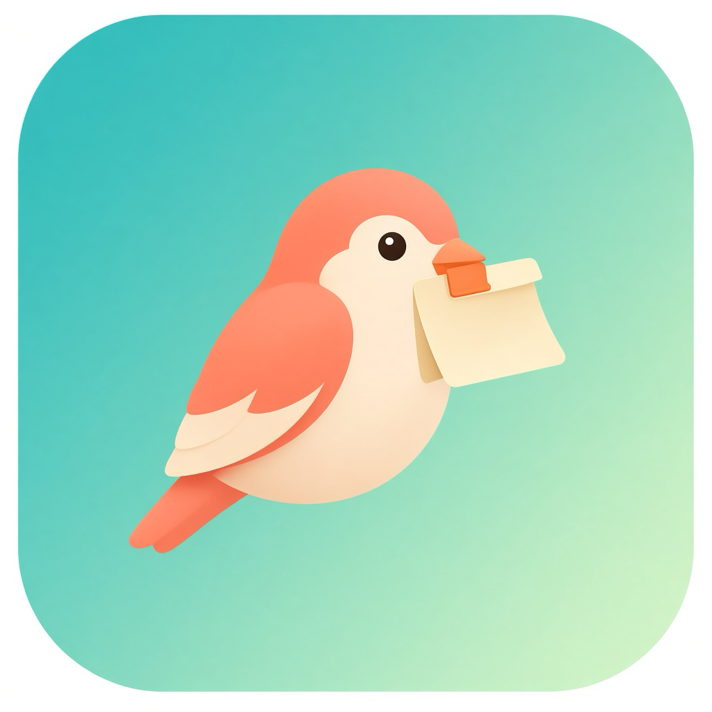

# Pastefinch

<p align="center">
  
</p>

<p align="center">
  <b>English</b> · <a href="README.zh-CN.md">中文</a>
</p>

<p align="center">
  A lightweight macOS menu bar app for clipboard history and screenshot history.
</p>

<p align="center">
  
  
  
  <a href="https://github.com/Antlers0/Pastefinch/releases"></a>
</p>

## Features

| | |
|---|---|
| 📋 | **Clipboard history** — text, images, and files |
| 🖼️ | **Screenshot history** — system screenshots and clipboard captures |
| 🔍 | **Search** — quickly find what you copied |
| ⌨️ | **Hotkey** — `⌥⌘V` to show or hide the panel |
| 🗑️ | **Cleanup** — per-item delete, clear all, auto trim by count |
| 🔒 | **Local only** — data stays on your Mac |

## Requirements

- macOS 13.0 or later
- Xcode 15+ (to build from source)

## Install

Download the latest `Pastefinch.zip` from [Releases](https://github.com/Antlers0/Pastefinch/releases), unzip it, and move `Pastefinch.app` to Applications.

If Gatekeeper blocks an unsigned build, open Finder → right-click the app → **Open**.

## Build from source

```bash
xcodebuild \
  -project ClipShotHistory.xcodeproj \
  -scheme ClipShotHistory \
  -configuration Release \
  -derivedDataPath ./DerivedData \
  CODE_SIGN_IDENTITY="-" \
  CODE_SIGNING_ALLOWED=NO \
  build
```

Output:

```text
DerivedData/Build/Products/Release/Pastefinch.app
```

Package a zip:

```bash
ditto -c -k --keepParent \
  DerivedData/Build/Products/Release/Pastefinch.app \
  Pastefinch.zip
```

## Privacy

History is stored locally at:

```text
~/Library/Application Support/Pastefinch/
```

Pastefinch does not sync data to the cloud. Clipboard contents are stored in plain form — do not use it as a password manager. Clearing screenshot history does not delete original screenshot files on disk.

## License

Copyright © 2026 Pastefinch. All rights reserved.
