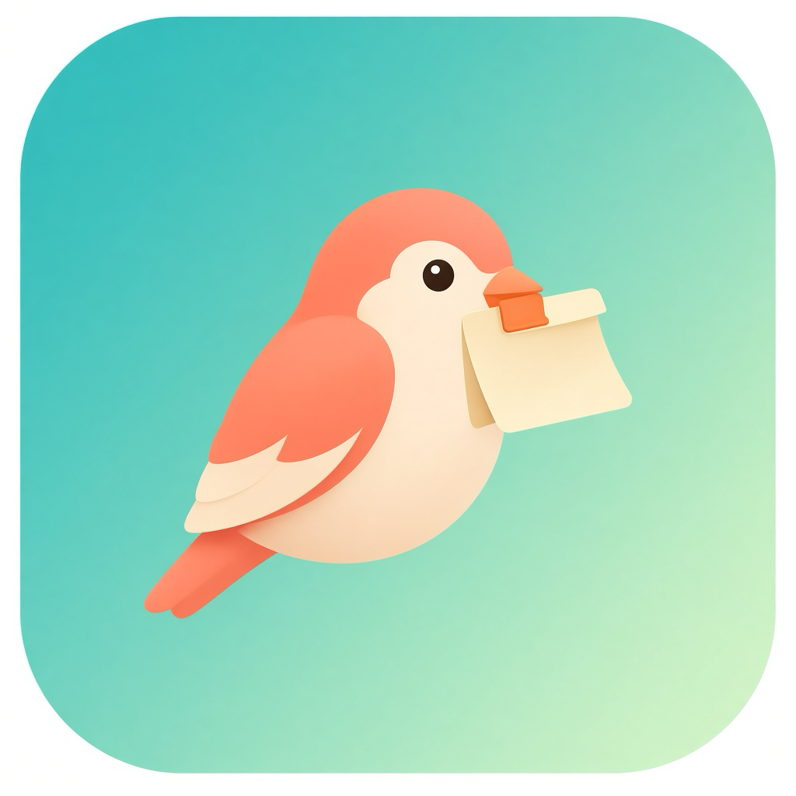

# Pastefinch

<p align="center">
  
</p>

<p align="center">
  <a href="README.md">English</a> · <b>中文</b>
</p>

<p align="center">
  轻量的 macOS 菜单栏工具：剪贴板历史 + 截图历史。
</p>

<p align="center">
  
  
  
  <a href="https://github.com/Antlers0/Pastefinch/releases"></a>
</p>

## 功能

| | |
|---|---|
| 📋 | **剪贴板历史** — 文本、图片、文件 |
| 🖼️ | **截图历史** — 系统截图与复制到剪贴板的截图 |
| 🔍 | **搜索** — 快速找回复制过的内容 |
| ⌨️ | **快捷键** — `⌥⌘V` 呼出 / 收起面板 |
| 🗑️ | **清理** — 单条删除、一键清空、按条数自动裁剪 |
| 🔒 | **仅本地** — 数据保存在本机 |

## 环境要求

- macOS 13.0 或更高版本
- 从源码构建需 Xcode 15+

## 安装

从 [Releases](https://github.com/Antlers0/Pastefinch/releases) 下载最新的 `Pastefinch.zip`，解压后将 `Pastefinch.app` 拖入「应用程序」。

若未签名构建被系统拦截，可在 Finder 中右键 App → **打开**。

## 从源码构建

```bash
xcodebuild \
  -project ClipShotHistory.xcodeproj \
  -scheme ClipShotHistory \
  -configuration Release \
  -derivedDataPath ./DerivedData \
  CODE_SIGN_IDENTITY="-" \
  CODE_SIGNING_ALLOWED=NO \
  build
```

产物路径：

```text
DerivedData/Build/Products/Release/Pastefinch.app
```

打包 zip：

```bash
ditto -c -k --keepParent \
  DerivedData/Build/Products/Release/Pastefinch.app \
  Pastefinch.zip
```

## 隐私说明

历史记录保存在：

```text
~/Library/Application Support/Pastefinch/
```

Pastefinch 不会将数据同步到云端。剪贴板内容以明文存储，请勿当作密码管理器使用。清空截图历史不会删除磁盘上的系统截图原文件。

## 许可证

Copyright © 2026 Pastefinch. All rights reserved.
